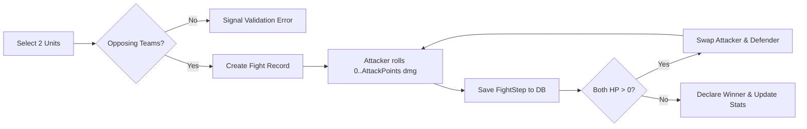
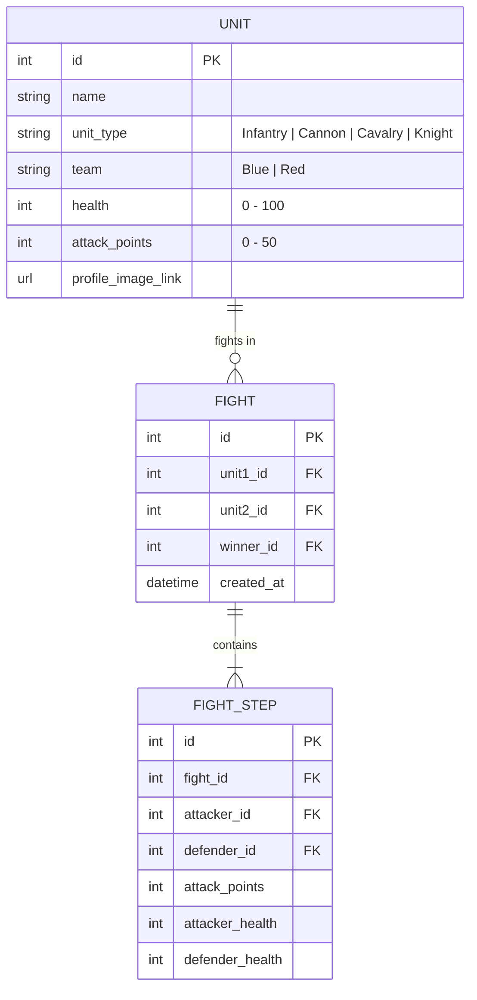

<div align="center">


[](https://bestcj.ro/)
[](https://bestcj.ro/)
[](https://www.python.org/)
[](https://www.djangoproject.com/)

*“General Deadlock is defending his fortress against an army of malicious actors. Gather your forces, align your ranks, and simulate the battle for survival.”*

</div>

---

## 🛡️ Overview

**Django War Simulator** is a full-stack web application built with **Django** for the **CodeRun V7** hackathon organized by **BEST Cluj-Napoca**. The platform allows commanders to recruit warrior units into the **Blue** or **Red** armies, manage their health on the battlefield, simulate turn-based 1v1 battles with step-by-step combat logs, and analyze global war statistics.

---

## ⚔️ Key Features

### 1. Unit Recruitment (`/unit`)
* Create and enlist new fighters into the database via a validated Django form.
* **Unit Classes:** `Infantry`, `Cannon`, `Cavalry`, and `Knight`.
* **Factions:** `Blue` vs. `Red`.
* **Combat Attributes:**
  * **Health (`HP`):** Configurable between `0` and `100` (defaults to `100`).
  * **Attack Points (`ATK`):** Configurable between `0` and `50`.
  * **Profile Portrait:** Custom avatar via `ProfileImageLink`.
* Real-time validation and clear error signaling for invalid inputs.

### 2. Army Roster & Field Medic (`/unit/all` & `/unit/<unit-id>`)
* **Roster Cards:** Displays every enlisted fighter with a `50x50` profile portrait, name, class, faction, and current HP.
* **Instant Healing:** Any unit below maximum health (`< 100 HP`) gets a dedicated **Heal** button right on its card to restore full health in the database.
* **Unit Dossier (`/unit/<unit-id>`):** Clicking any fighter card opens their detailed profile page.

### 3. Turn-Based Combat Engine
* Select any **two fighters from opposing teams** (`Blue` vs. `Red`) directly from the roster and hit **Simulate**.
* **Battle Loop:** While both units remain standing (`HP > 0`), they exchange alternating blows, dealing randomized damage between `0` and their `AttackPoints`.
* Every strike is persisted in the database as a `FightStep` entity recording the **attacker**, **defender**, **damage dealt**, and **remaining HP** of both combatants.

### 4. War Chronicles & Faction Analytics
* **Fight History Cards:** Each unit's profile displays cards for every battle they participated in, detailing the step-by-step blow-by-blow log and the final winner.
* **Global War Statistics (`/unit/all`):** A dedicated analytics dashboard below the roster summarizing per-team performance:
  * Total Fights Participated
  * Overall Damage Caused
  * Overall Damage Taken

---

## 🗺️ System & Battle Architecture

### Combat Simulation Flow


### Database Schema (`ERD`)


---

## 🔗 URL Endpoints

| Route | Method | Description |
| :--- | :---: | :--- |
| `/unit` | `GET`, `POST` | Form interface to recruit and save a new fighter unit. |
| `/unit/all` | `GET` | Displays all fighters, healing actions, fight selector, and global team stats. |
| `/unit/<unit-id>` | `GET` | Detailed view of a specific fighter and all their recorded fight histories. |

---

## 🚀 Quickstart & Local Setup

1. **Clone the repository**
   ```bash
   git clone https://github.com/<YourUsername>/<TeamName>-DjangoChallenge-Easy.git
   cd <TeamName>-DjangoChallenge-Easy
   ```

2. **Create and activate a virtual environment**
   ```bash
   python -m venv venv
   # On Linux/macOS:
   source venv/bin/activate
   # On Windows:
   venv\Scripts\activate
   ```

3. **Install dependencies**
   ```bash
   pip install -r requirements.txt
   ```

4. **Apply database migrations**
   ```bash
   python manage.py makemigrations
   python manage.py migrate
   ```

5. **Run the development server**
   ```bash
   python manage.py runserver
   ```
   Open `http://127.0.0.1:8000/unit` in your browser to recruit your first warrior!

---

<div align="center">

Built with ⚔️ and **Django** for **CodeRun V7** • **BEST Cluj-Napoca**

</div>
